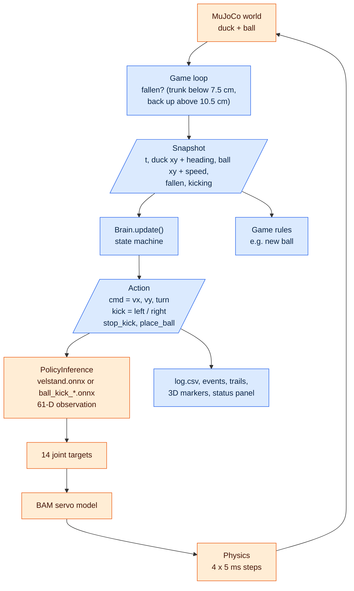
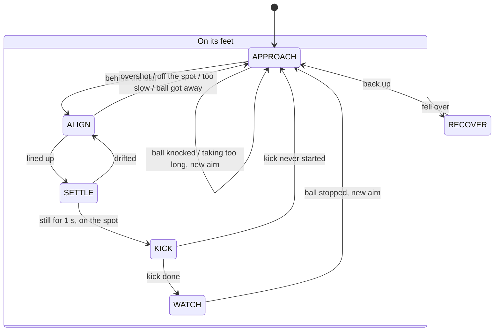
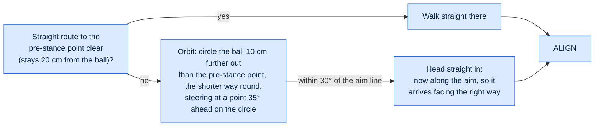
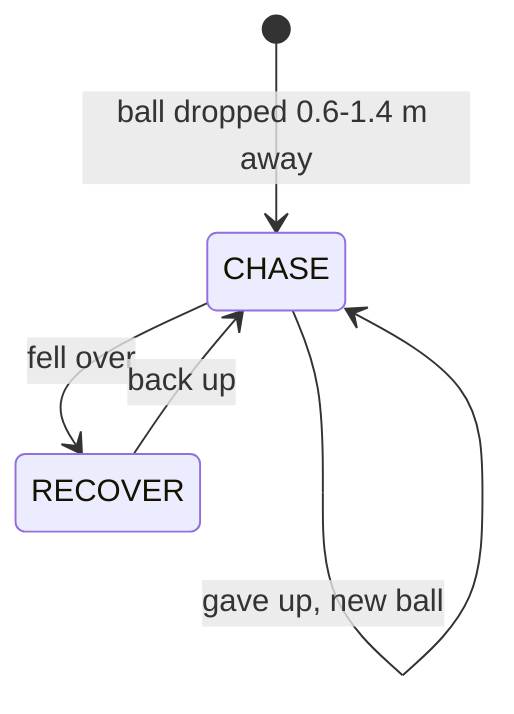
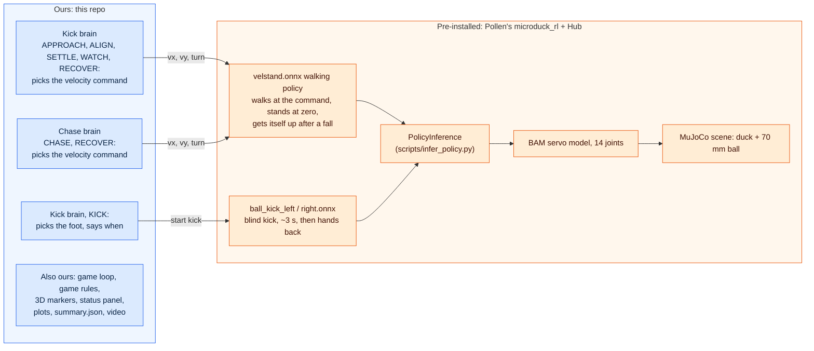

# How it works

Two systems, one loop: **chase**, and **kicking** (the endless kick loop, plus
its kickback variant). Pollen's pre-trained policies are the **legs** and the
**boot**; everything we wrote is the **brain** that decides what to send them,
plus the game rules, the 3D markers and the plots.

Colours in every diagram: **blue = ours** (this repo), **orange = pre-installed**
(Pollen's `microduck_rl` and their policies on the Hugging Face Hub).

## The 50 Hz loop

Every 20 ms, for both games (`common/game.py: Game.tick`):

The brain never touches MuJoCo: it only sees a `Snapshot` and returns an
`Action` (`common/brain.py`). That's why `tests/` can check brains against an
imaginary duck in a fraction of a second.

## Kick loop: the brain's state machine

`kick/brain.py`. The edge labels are short versions of the reasons the brain
prints (and shows in the viewer); the table below gives the exact conditions.

| Transition | Exact condition (`KickParams` defaults) |
|---|---|
| APPROACH → ALIGN | trunk within 3 cm of the pre-stance point, 20 cm behind the kick stance (reached straight or via the orbit below) |
| ALIGN → SETTLE | facing the aim within 8° and the ball within 12 mm (0.8 × 15 mm tolerance) of the kick spot, or within 15 mm once fully walked in; held for 0.3 s while standing |
| ALIGN → APPROACH | walked 15 mm past the stance ("overshot"); right depth and heading but ball still off the spot ("can't shuffle"); 15 s in ALIGN; or more than 32 cm from the stance ("ball got away") |
| SETTLE → KICK | after 1 s standing: ball within 15 mm, heading within 12° |
| SETTLE → ALIGN | after 1 s: ball drifted off (more than 15 mm or 12°) |
| KICK → WATCH | the kick policy ran (~3 s) and handed back to walking |
| KICK → APPROACH | the kick policy hadn't started after 0.5 s |
| WATCH → APPROACH | ball slower than 5 cm/s (after at least 0.5 s), or 6 s: score the kick, pick a new aim |
| → APPROACH, new aim | from APPROACH / ALIGN / SETTLE: ball moved over 5 cm since aiming and is still ("ball knocked"); from any state but KICK: 45 s since the duck got within 60 cm of the ball ("taking too long") |
| → RECOVER | trunk below 7.5 cm, from any state (a running kick is stopped) |
| RECOVER → APPROACH | trunk back above 10.5 cm |

New aims are random: roughly onwards (the duck->ball direction ±60°), or back
towards the middle (±45°) when the ball is outside the 1.5 m arena.

Inside ALIGN the brain does one of: turn on the spot (facing over 15° off),
walk in along the line steering like a car, or give up and retry. The real
walking policy can't sidestep, walk backwards or take tiny steps, so retrying
is the only way to fix a small miss.

### Getting behind the ball: the orbit

In APPROACH the duck heads for the **pre-stance point** (20 cm behind where it
must stand to kick, on the aim line). If the straight way there would take it
closer than 20 cm to the ball, it **orbits** instead:

Near 180° (both ways round equally long) it keeps the way it started, so it
can't dither. The route it's following, arc included, is `brain.plan`, which
the viewer draws. Every orbit is logged in `events.json` (`orbits`). In MuJoCo
it orbits ~5 times per 5 minutes in the kick loop, almost always for a
reversal after the ball leaves the arena, and before every kick in kickback.

## Kickback: back and forth on a line

`kick/kickback.py`. The same brain with one different method,
`KickbackBrain.pick_aim`: each kick goes **back the way the last one went**, at
the end of a 1 m line behind the last kick's direction (the first kick goes
away from the duck). It aims at that end from wherever the ball stopped, so a
ball that drifted off the line is steered back towards it. Every kick then
needs the duck to get round the ball, which is what the orbit is for.

## Chase: the brain plus the game rules

Brain: `fetch/chaser.py` (two states). Rules: `fetch/chase_ball.py`.

"Reached it" = trunk within 13 cm of the ball; "gave up" = 25 s on one ball.
Fallen = trunk below 7.5 cm, back up = above 10.5 cm.
In CHASE the command comes from `common/steer.py: steer_to`: turn towards the
ball, walk only when roughly facing it, slow down near it, and never send a
forward command the walking policy would ignore (below 0.3 m/s).

## Who does what

| State | Ours | Pre-installed (Pollen) |
|---|---|---|
| APPROACH | where to walk (behind the ball, round it if needed), the command | velstand walks |
| ALIGN | turn / walk in / give up, the command | velstand walks and turns |
| SETTLE | zero command, checks it's still lined up | velstand stands still |
| KICK | which foot, when, nothing else | ball_kick ONNX runs the whole kick, then hands back to velstand |
| WATCH | zero command, scores the kick, picks the next aim | velstand stands still |
| CHASE | `steer_to` the ball, the command | velstand walks |
| RECOVER | zero command, waits | velstand's built-in get-up |
| always | game loop, rules, markers, plots | PolicyInference, BAM servos, MuJoCo physics |

## Watching the brain live

The viewer's top-left panel shows the brain's `state` and **why** it last
changed (e.g. `ALIGN -> APPROACH (overshot the ball)`). The same lines are
printed to the terminal, and `log.csv` has a `state` column for every step
(the kick loop's `timeline.png` draws it).

## Adding things

- **A new brain** (e.g. a learned Stage-1 chaser): any object with
  `update(snapshot) -> Action`, `state`, `last_change` and `events`.
  Subclass `common.brain.Brain` to get the last three. Pass it to `Chase(...)`
  in `fetch/chase_ball.py:main` instead of `ChaseBrain()`.
- **A new game**: subclass `common.game.Game` and give it a brain, `start()`,
  and optionally `rules()`, `draw()`, `status()`, `log_row()`, `summary()`,
  `plots()`. Then `sim.run(duck, game, args, "name")`. Falls, stepping,
  logging, trails and the live / headless runners come for free.
- **Test it** like `tests/test_chaser.py`: feed Snapshots from an imaginary
  duck (`tests/legs.py:lazy_legs` makes it move like the real legs).
