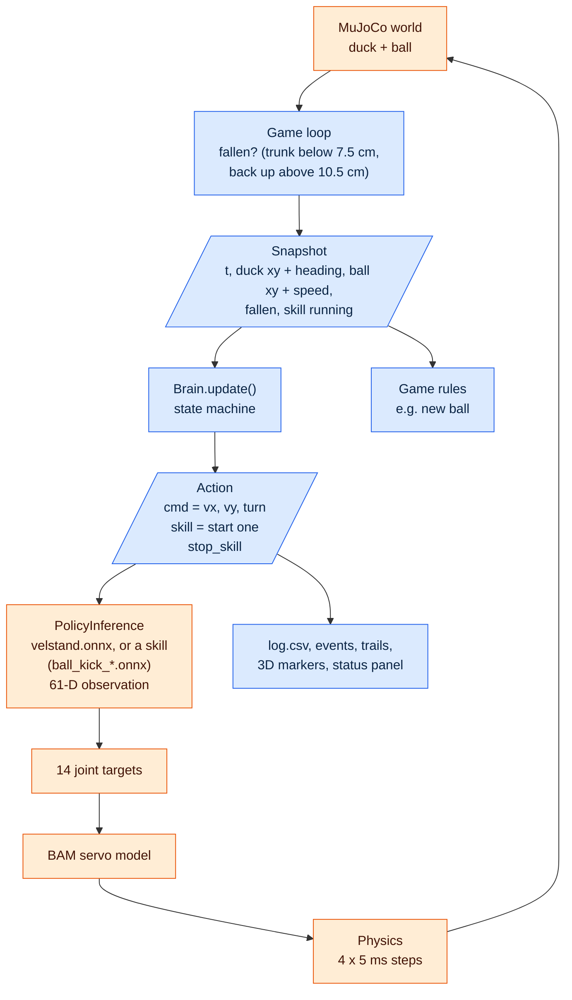
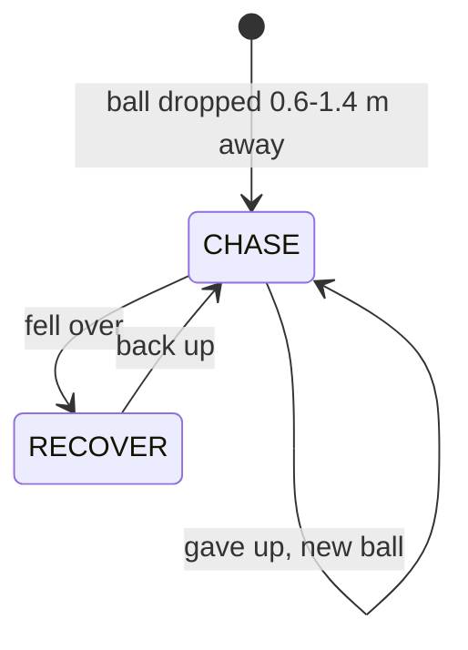
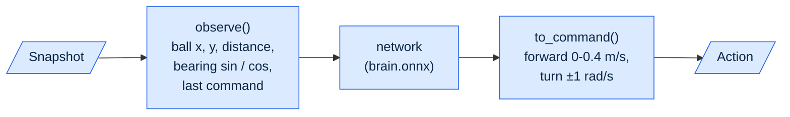
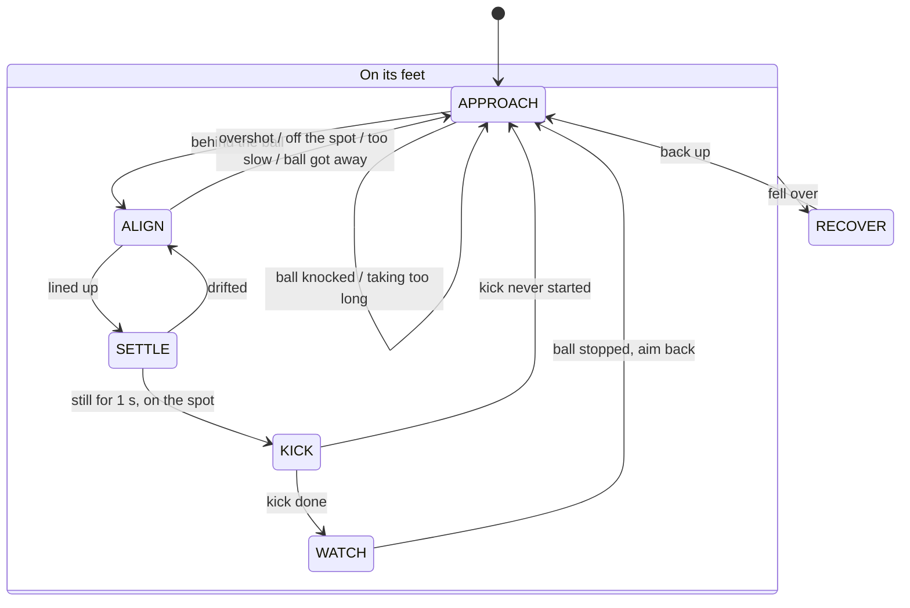
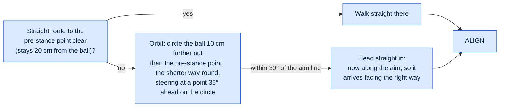

# How it works

Two behaviours, one loop: **chase** and **kickback**. Pollen's pre-trained
policies are the **legs** (walking) and the **skills** (the kick); everything
we wrote is the **brain** that decides what to send them, plus the game rules,
the 3D markers and the plots.

Colours in every diagram: **blue = ours** (this repo), **orange = pre-installed**
(Pollen's `microduck_rl` and their policies on the Hugging Face Hub).

## The 50 Hz loop

Every 20 ms, for both games (`common/game.py: Game.tick`):

The brain never touches MuJoCo: it only sees a `Snapshot` and returns an
`Action` (`common/brain.py`). So the same brain runs unchanged in
`common/toy.py`, a numpy duck and ball that `tests/` use and that a learned
brain can be trained in.

A **skill** is any Pollen episodic policy loaded by name (`common/duck.py`):
`Action(skill="kick_left")` swaps it in for its fixed time (3 s for a kick),
during which the walking command is ignored; then control hands back to walking.

## Chase: the brain plus the game rules

Brain: `chase/brain.py` (two states). Rules: `chase/game.py`.

"Reached it" = trunk within 13 cm of the ball; "gave up" = 25 s on one ball.
In CHASE the hand-written `ChaseBrain` gets its command from
`common/steer.py: steer_to`: turn towards the ball, walk only when roughly
facing it, slow down near it, and never send a forward command the walking
policy would ignore (below 0.3 m/s).

`LearnedBrain` (`--brain file.onnx`) has the same two states, but in CHASE a
small network picks the command instead, 10 times a second:

`chase/train.py` trains it with PPO in the toy world (lazy legs), rewarding
progress towards the ball (10 per metre) and each catch (10), in 30 s
episodes with a new ball after every catch.

## Kickback: the brain's state machine

`kickback/brain.py`. Every kick aims back the way the last one went, at the end
of the line behind it (the first kick goes away from the duck), from wherever
the ball stopped, so a ball that drifted off the line is sent back towards it.

The kick policy is **blind**: it never sees the ball, kicks straight ahead,
and was trained with the ball 9 cm ahead and 4.2 cm to the side of the trunk
(±1.5 cm). So the kick's direction is just which way the duck faces, and
lining up is the whole game.

The edge labels are short versions of the reasons the brain prints (and shows
in the viewer); the table gives the exact conditions.

| Transition | Exact condition (`KickbackParams` defaults) |
|---|---|
| APPROACH → ALIGN | trunk within 3 cm of the pre-stance point, 20 cm behind the kick stance (reached straight or via the orbit below) |
| ALIGN → SETTLE | facing the aim within 8° and the ball within 12 mm (0.8 × 15 mm tolerance) of the kick spot, or within 15 mm once fully walked in; held for 0.3 s while standing |
| ALIGN → APPROACH | walked 15 mm past the stance ("overshot"); right depth and heading but ball still off the spot ("can't shuffle"); 15 s in ALIGN; or more than 32 cm from the stance ("ball got away") |
| SETTLE → KICK | after 1 s standing: ball within 15 mm, heading within 12° |
| SETTLE → ALIGN | after 1 s: ball drifted off (more than 15 mm or 12°) |
| KICK → WATCH | the kick skill ran (~3 s) and handed back to walking |
| KICK → APPROACH | the kick skill hadn't started after 0.5 s |
| WATCH → APPROACH | ball slower than 5 cm/s (after at least 0.5 s), or 6 s: score the kick, aim the next one |
| → APPROACH, aim again | from APPROACH / ALIGN / SETTLE: ball moved over 5 cm since aiming and is still ("ball knocked"); from any state but KICK: 45 s since the duck got within 60 cm of the ball ("taking too long") |
| → RECOVER | trunk below 7.5 cm, from any state (a running kick is stopped) |
| RECOVER → APPROACH | trunk back above 10.5 cm |

Inside ALIGN the brain does one of: turn on the spot (facing over 15° off),
walk in along the line steering like a car, or give up and retry. The real
walking policy can't sidestep, walk backwards or take tiny steps, so retrying
is the only way to fix a small miss.

### Getting behind the ball: the orbit

In APPROACH the duck heads for the **pre-stance point** (20 cm behind where it
must stand to kick, on the aim line). After every kick that point is on the far
side of the ball, so it **orbits**:

Near 180° (both ways round equally long) it keeps the way it started, so it
can't dither. The route it's following, arc included, is `brain.plan`, which
the viewer draws in cyan. Every orbit is logged in `events.json` (`orbits`).

## Who does what

| State | Ours | Pre-installed (Pollen) |
|---|---|---|
| CHASE | `steer_to` the ball, the command | velstand walks |
| APPROACH | where to walk (behind the ball, round it if needed), the command | velstand walks |
| ALIGN | turn / walk in / give up, the command | velstand walks and turns |
| SETTLE | zero command, checks it's still lined up | velstand stands still |
| KICK | which foot, when, nothing else | the kick skill runs the whole kick, then hands back to velstand |
| WATCH | zero command, scores the kick, aims the next | velstand stands still |
| RECOVER | zero command, waits | velstand's built-in get-up |
| always | game loop, rules, markers, plots | PolicyInference, BAM servos, MuJoCo physics |

## Watching the brain live

The viewer's top-left panel shows the brain's `state` and **why** it last
changed (e.g. `ALIGN -> APPROACH (overshot the ball)`). The same lines are
printed to the terminal, and `log.csv` has a `state` column for every step
(kickback's `timeline.png` draws it).

Three markers come from the loop itself (`Game.draw`), so every game and every
brain gets them: **cyan**, the brain's `plan`; **pink**, the command, drawn as
where it would take the duck in 2 s; **white**, where the duck is actually
going in 2 s (smoothed over 0.5 s). Pink and white on the same scale is the
quickest way to see the legs not doing what the brain asked: dead zones, the
~30% walking speed, turns that don't happen. Games add their own and list them
in `legend`; all colours are defined once, in `common/overlay.py`.
